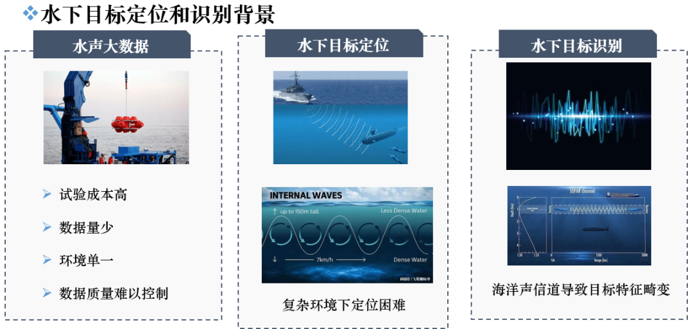
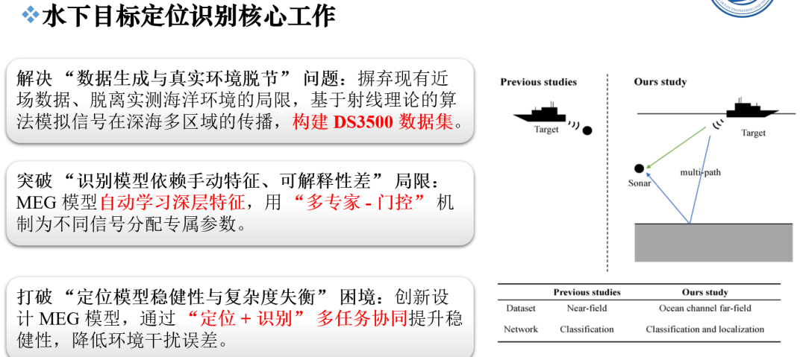
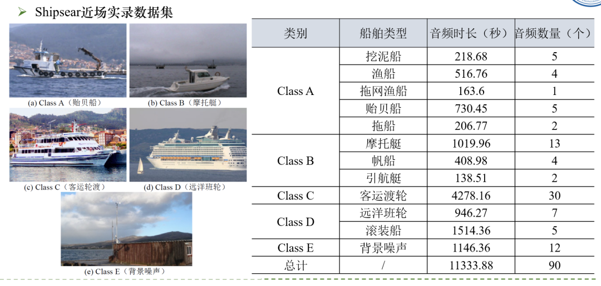
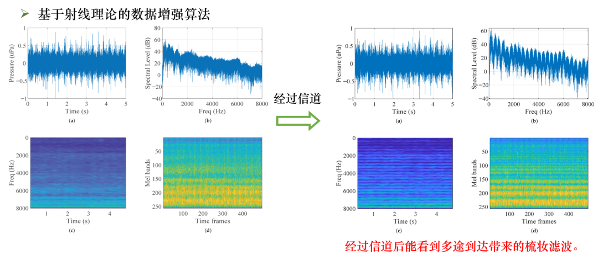
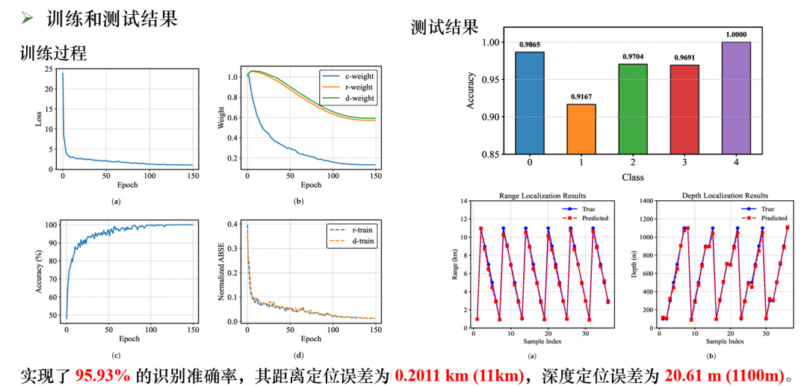
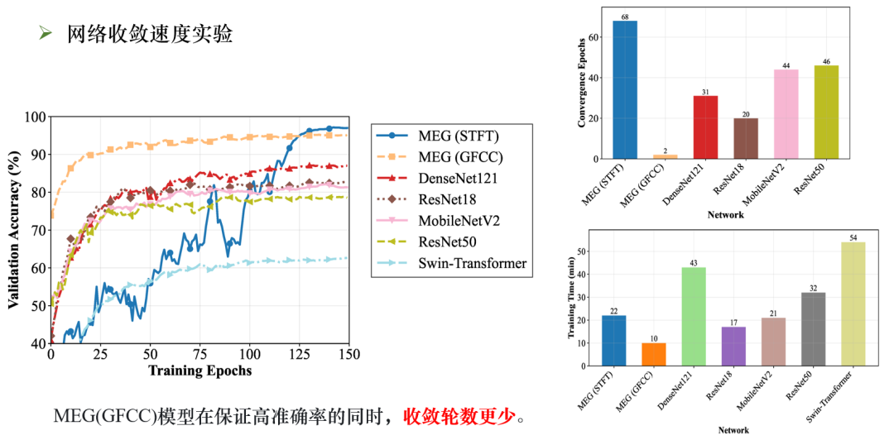
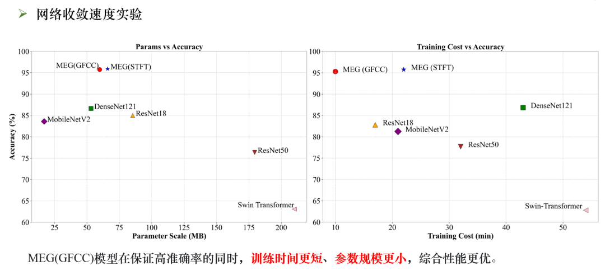

# New Breakthrough in Underwater Positioning and Identification - MEG Multi-Task Mixed Expert Model Explanation with Python Code

This study proposes a data augmentation method based on ray theory to address the scarcity of underwater acoustic data in deep-sea environments, which poses significant challenges to data-driven target recognition models and severely limits their performance. To solve this issue, we have developed a new MEG (Multi-Task, Multi-Expert, Multi-Control) framework that utilizes relative positional information between targets and sonar to achieve simultaneous localization and recognition of underwater targets. This framework employs a multi-expert mechanism to dynamically partition the parameter space and adaptively fuse task-specific features using a multi-control attention mechanism, achieving joint prediction for target localization and recognition. Experimental results on the DS3500 dataset demonstrate that the MEG framework achieves an accuracy rate of 95.93% in target recognition, with a localization error of 0.2011 km in direct range, 20.61 m in depth, and a maximum detection distance of 11 km and a maximum detection depth of 1100 m. This study provides a new technical solution for underwater acoustic target recognition in deep-sea environments and offers innovative ideas for practical applications in marine monitoring and coastal defense.
Underwater acoustic target recognition is a research focus in the field of marine acoustics, where the technology autonomously identifies different target categories by analyzing the radiation noise of underwater objects. It is widely applied in underwater monitoring, protection, and enhancement of coastal defense capabilities. In recent years, deep learning has become the core technology for underwater acoustic identification systems.
However, traditional underwater acoustic detection methods mainly rely on near-field datasets. Although deep learning-based data-driven acoustic recognition models perform well on public datasets, the complex time-varying characteristics of marine channels still pose numerous problems. Underwater acoustic signals are affected by factors such as seawater temperature, salinity, depth, and seabed topography during transmission, leading to signal attenuation, scattering, and multipath propagation, resulting in blurred and distorted received underwater acoustic signals.
Regarding this, the research team adopted a marine acoustic channel simulation method based on ocean acoustic propagation theory to generate far-field datasets. Taking into account complex factors such as multipath propagation, they broke through the limitations of traditional near-field datasets. Most existing underwater acoustic identification researches only label categories as supervision information, while the latest advances in machine learning technology provide possibilities to utilize information beyond category labels. Multitask learning is one highly promising solution.
This study introduces a multitask learning framework, treating "estimating the relative position of the target and sonar" as the localization task, enabling the recognition task to perceive robust patterns related to the relative position of the target-sonar in underwater signals; when constructing datasets based on an acoustic field model, synchronously labeling the localization task's tags can also prompt the model to learn acoustic features related to the target, such as comb filtering and interference fringes, deepening the model's understanding of signals. Influenced by hybrid expert models and multi-gate mechanisms, the study adopts an improved multitask framework MEG, fully tapping into the potential of multitask learning: this framework replaces the traditional output layer with multiple independent network layers, each architecture identical but parameterized differently, allowing specialized learning for different task dimensions; at the same time, it dynamically learns task-specific weights through multiple gate layers and introduces a top-k gate mechanism to dynamically select the most relevant expert layer according to task importance, enhancing model efficiency and performance. To verify the superior performance of this multitask framework and MEG model, the study generated a synthetic dataset of ship radiation noise in deep sea areas with direct and shadow zones based on ray theory data enhancement methods, and conducted a series of experiments on this dataset, validating the model's excellent performance in both localization and recognition tasks.
Method overview The research methodology mainly revolves around the construction of datasets and the design of the MEG multitask hybrid expert model, clarifying the model's loss function, evaluation metrics, and training parameters. Specifically, it is as follows:
1. Dataset construction
Based on the ShipsEar ship radiation noise dataset, preprocessing is conducted to remove blank segments and divide into 5-second short clips. A sequential sampling strategy with a 5-fold cross-validation is used to split the training set and test set. Data augmentation methods are proposed based on ray theory, combined with the BELLHOP model to construct an acoustic field environment for 3500 meters deep sea. The simulated ship radiation noise signals received by sonar in this environment are then used to generate the DS3500 dataset, which includes 36 positions. Additionally, the interference analysis of direct-path-reflected paths and reflected-reflected paths is supplemented, revealing the comb filter effect of oceanic channels on target features and the changing patterns of interference stripes.
1  
MEG model design
The model is centered around multi-task learning, integrating multiple experts and multi-gate mechanisms. It is divided into three parts: the localization task head, classification task head, and a hybrid expert network. Both the localization and classification task heads draw on the feature extraction capabilities of MSRANET networks. The former has a more complex structure, incorporating convolutional modules, residual convolutional modules, and feature concatenation operations, while the latter is simplified, primarily featuring convolutional modules. The hybrid expert network consists of five expert layers, where the gate layer computes the task weights for each expert layer, and combined with a top-k mechanism, selects the three best expert layers to provide exclusive features for the task.
1  
Loss Function and Evaluation Indicators
Design a multi-task loss function, where the localization task calculates prediction errors in distance and depth using mean squared error (MSE), while the recognition task computes class prediction bias using cross-entropy loss. Additionally, introduce learnable weight coefficients and regularization terms to address variance and offset discrepancies of single-task losses. Recognition tasks evaluate with accuracy, precision, recall, and F1-score, while localization tasks employ average absolute error and average absolute percentage error. Furthermore, normalize the localization errors into percentage scores for intuitive comparison.
1  
Training parameter settings
Build the training environment based on PyTorch 2.4.1 framework, initial learning rate set to 0.001, adopting a linear warmup and cosine annealing learning rate adjustment strategy with 20 rounds; batch size is set to 64, using Adam as the optimizer, He initialize method for network parameters, total training rounds are 150, and multi-task loss function is used to complete model training.
Conclusion: This study addresses the long-standing issues of data scarcity and poor generalization capabilities in existing models in the field of underwater acoustic target recognition. It proposes a data augmentation model based on ray theory and an MEG (Multi-Task, Multi-Gating, Multi-Expert) recognition framework. The effectiveness of the proposed method has been verified through extensive experiments. The main research findings are as follows:
1  
A data augmentation model based on the Ray Theory is constructed to extend the ShipsEar dataset, generating a DS3500 dataset covering the direct area and shadow area of the deep sea with a depth of 3500 meters. This model can effectively simulate the ship radiation noise captured by sonar in marine channels, enriching the diversity of training data and providing high-quality data support for model training.
2  
The innovative MEG multi-task framework possesses efficient feature learning and task fusion capabilities: incorporating positioning tasks into the model allows it to learn relative positional information between targets and sonar, enhancing robust pattern extraction capabilities. Integrating multi-experts and multi-gate mechanisms, assigning independent parameter spaces for different underwater signals, combined with task-specific expert allocation strategies, effectively reduces interference among tasks.
3  
Comparative experiments on the DS3500 dataset demonstrate that the MEG model significantly outperforms mainstream networks such as ResNet and Swin-Transformer. It not only achieves a high recognition accuracy of 95.93% but also achieves distance positioning errors of 0.2011 km and depth positioning errors of 20.61 m, performing exceptionally well in underwater target positioning and recognition joint tasks.
Overall, this study provides a practical technical solution for underwater target positioning and recognition. The proposed data augmentation model and MEG framework are both theoretically valuable and practically meaningful. Future research can focus on optimizing the structure and parameters of the MEG model to adapt it to more complex marine environments. At the same time, this framework can be integrated with advanced technologies such as reinforcement learning and transfer learning to further expand its application scenarios in marine acoustics.

## Images

<!-- PAYMENT_BLOCK -->

## Get this dataset

- Payment link (Stripe): [Buy now](https://buy.stripe.com/3cs8yP7sY87d0vu9AB)
- Payment QR code: 

<!-- /PAYMENT_BLOCK -->
